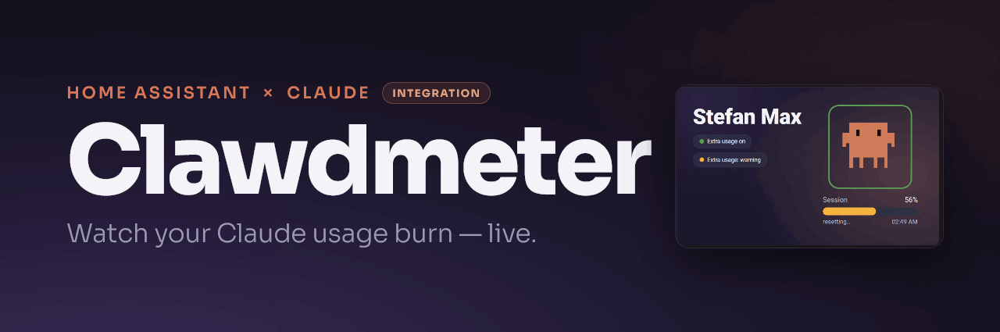

<p align="center">
  
</p>

<h1 align="center">Clawdmeter — Claude Usage for Home Assistant</h1>

<p align="center"><em>Know exactly how much Claude you have left — and how fast you're burning it.</em></p>

<p align="center">
  <a href="https://www.home-assistant.io"></a>
  <a href="custom_components/clawdmeter/quality_scale.yaml"></a>
  
  
  
</p>

<p align="center">
  <a href="https://my.home-assistant.io/redirect/hacs_repository/?owner=corgan2222&repository=ha-clawdmeter&category=integration"></a>
  <a href="https://my.home-assistant.io/redirect/config_flow_start/?domain=clawdmeter"></a>
</p>

<p align="center">
  <a href="https://github.com/corgan2222/esphome-modular-lvgl-buttons"></a>
  <a href="https://github.com/corgan2222/ha-clawdmeter"></a>
  <a href="https://github.com/corgan2222/lovelace-clawdmeter"></a>
</p>

Clawdmeter polls Anthropic's usage API and turns it into a full set of Home Assistant
sensors — session and weekly limits, reset countdowns, and a layer of **computed
metrics the API doesn't give you**: live burn rate, time-to-limit, a "runway" verdict
and a color-coded pace frame. Built to pair with the pixel-art Clawdmeter ESPHome
display, but great on its own dashboard too.

## ✨ Highlights

- **Session, weekly, Sonnet & Opus usage** with reset timestamps and a live "resets in" countdown.
- **Burn rate (5 min & 30 min)** in %/h — see how fast you are spending right now.
- **Time to limit** — minutes until you hit 100% at the current pace.
- **Runway** — does the session reset before you run out? You get a pace ratio, a signed
  margin and a "limit reached before reset" alert.
- **Pace frame & animation mood** — green/orange/red plus idle→heavy buckets, ready to
  drive a dashboard accent or an ESPHome creature.
- **Extra usage / overage** — credits, limit, percentage and a status (normal/warning/critical), from the legacy *and* new spend API.
- **Multi-account** — run a Pro and a Max account side by side; each gets its own device.
- **Resilient** — rides out brief API outages by holding the last values for a grace window instead of flipping everything to "unavailable".
- **English & German** UI out of the box, plus a configurable poll interval.

## 🎯 Use cases

- **Stay below your limits** — see at a glance how much of the session and weekly
  allowance is gone, on any dashboard.
- **Get warned in time** — a notification when usage passes a threshold, or when the
  current pace would hit the limit before it resets.
- **Plan heavy work** — time to limit and runway tell you whether a long session still
  fits before the next reset.
- **Put it on your desk** — drive the animated Lovelace card or the ESPHome panel.
- **Watch extra usage spend** — percentage, credits and the monthly limit.

## 🃏 Animated Lovelace card

A companion animated card draws the **real pixel-art creature** (the original
[Clawdmeter](https://github.com/HermannBjorgvin/Clawdmeter) / [claudepix](https://claudepix.vercel.app)
animations) right on your dashboard. The creature's mood follows your burn rate
(idle → heavy) and its frame glows green/orange/red with the runway pace — exactly like
the ESPHome display.

<p align="center">
  
</p>

It lives in its own repository — **[corgan2222/lovelace-clawdmeter](https://github.com/corgan2222/lovelace-clawdmeter)** (Marketplace plugin, `type: custom:clawdmeter-card`).

## 🐾 ESPHome companion

These sensors are built to feed the animated **Clawdmeter** pixel-art display in
[esphome-modular-lvgl-buttons](https://github.com/corgan2222/esphome-modular-lvgl-buttons) — a
small ESP32 + LVGL screen that shows your Claude usage at a glance. The creature's mood
(idle → heavy) follows your burn rate, the breathing frame glows green/orange/red with the
runway pace, and the panel surfaces the usage and projection numbers — all driven straight
from the metrics above. Point the device's templates at your `clawdmeter` entities and it
stays in sync on every poll.

<p align="center">
  
</p>

## 📊 Entities

Every account becomes one device named `Claude <name> (<plan>)`, so entities read as
`claude_<name>_<plan>_<type>`. The plan is read from your profile on every start, so the
device and the Plan sensor follow an upgrade; entity ids keep the plan they were created
under. In the device view they split into two groups: the
locally **computed** projections are the primary **Sensors**, and the **raw API**
readings sit under **Diagnostic**.

**Sensors** — computed by the integration:

| Group | Entities |
| --- | --- |
| Burn rate | Burn rate 5m · Burn rate 30m · Burn rate per minute · Usage rate |
| Projection | Time to limit · Session limit ETA |
| Runway | Runway pace · Runway margin · Limit reached before reset |
| Pace & peaks | Weekly pace · Session resets in · Session usage peak today |
| Mood | Animation group · Pace frame |

**Diagnostic** — straight from the usage / profile API:

| Group | Entities |
| --- | --- |
| Account | Account · Plan |
| Usage | Session usage · Weekly usage · Weekly model usage · Weekly Sonnet usage · Weekly Opus usage |
| Resets | Session reset · Weekly reset · Weekly Sonnet reset · Weekly Opus reset |

The Sonnet and Opus sensors only exist for accounts that report a weekly cap for that model.
Weekly model usage covers whichever model is capped, and lists all of them in its `models`
attribute.
| Overage | Extra usage · Extra usage status · Extra usage credits · Extra usage limit · Extra usage enabled |

## 💤 States when Claude is idle

When nobody is using Claude — nights, weekends, holidays — the limits aren't moving.
Instead of showing "unknown" everywhere, Clawdmeter reports per-entity idle states that
keep history graphs continuous and meaningful:

| Entity | Idle state | Why |
| --- | --- | --- |
| Burn rate 5m / 30m · Usage rate | `0` | No consumption means zero burn — and a gap-free graph over nights and weekends |
| Runway pace | `0` | At this pace the limit is never reached |
| Pace frame · Animation group | `green` · `idle` | Calm creature |
| Limit reached before reset | `off` | Nothing at risk |
| Time to limit · Runway margin | `unknown` | No ETA exists while usage is flat — a `0` would wrongly read as "at the limit now" |

Accounts without a five-hour window project from the weekly window instead (their
`window` attribute reads `weekly`). There the projections use the average rate since the
week opened rather than the last 30 minutes, so they stay populated while you are idle.
| Usage %, resets, extra usage | live API value | Reflect the account regardless of activity |

## 🔄 How data is updated

- Clawdmeter polls Anthropic's usage endpoint every **300 s** by default (60 to 3600 s,
  see [Configuration](#-configuration)). Each poll is one request.
- The profile (account name and plan) is read once each time the integration starts, so
  a plan upgrade shows up after the next restart without signing in again.
- The access token is renewed automatically shortly before it expires.
- Burn rates and projections are computed locally from the polls of the last 30
  minutes. That window and the day's peak are stored, so a restart does not reset them.
- On plans without a five-hour limit, such as Ultra, the projections use the average
  rate since the week opened instead of the last 30 minutes.
- When the API is unreachable, the last values are kept for up to six polls (about 30
  minutes at the default interval) before the entities become unavailable. The outage
  is logged once, and once more when it ends.

## 🚀 Installation

<p align="center">
  <a href="https://my.home-assistant.io/redirect/hacs_repository/?owner=corgan2222&repository=ha-clawdmeter&category=integration"></a>
  <a href="https://my.home-assistant.io/redirect/config_flow_start/?domain=clawdmeter"></a>
</p>

Clawdmeter needs Home Assistant 2026.11 or newer.

**Marketplace (recommended)**

1. **[Add this repository to the Marketplace](https://my.home-assistant.io/redirect/hacs_repository/?owner=corgan2222&repository=ha-clawdmeter&category=integration)** (or add `https://github.com/corgan2222/ha-clawdmeter` as a custom repository of the category **Integration** in the Marketplace), then install **Clawdmeter** and restart Home Assistant.
2. **[Add the Clawdmeter integration](https://my.home-assistant.io/redirect/config_flow_start/?domain=clawdmeter)** (or **Settings → Devices & Services → Add Integration → Clawdmeter**).

**Manual** — copy `custom_components/clawdmeter` into your `config/custom_components/`
and restart.

## 🔑 Configuration

Clawdmeter authenticates with Anthropic over OAuth — there is no API key to manage:

1. Start the integration and open the authorization link it shows you.
2. Approve access and copy the code Anthropic displays (it may contain a `#` — copy the
   whole thing).
3. Paste it back and you are done. Add more accounts by repeating with a different login.

Two options sit under the integration's **Configure** button:

| Option | Default | What it does |
| --- | --- | --- |
| Update interval | 300 s | How often the usage API is polled, 60 to 3600 s. The API is rate limited, so keep it sensible. |
| Weekly window for plans without a session limit | on | On plans without a five-hour limit, such as Ultra, the session sensors and projections follow the weekly limit instead of staying empty. Plans with a five-hour limit are not affected. |

To sign in again or switch to another account, use **Reconfigure** in the entry's ⋮ menu.

## 🗑️ Removal

1. Go to **Settings → Devices & services → Clawdmeter**, open the entry's ⋮ menu and
   choose **Delete**. This removes the account, its entities and the stored burn-rate
   history.
2. To remove the code as well, uninstall **Clawdmeter** in the Marketplace (or delete
   `config/custom_components/clawdmeter` after a manual install) and restart Home
   Assistant.

## ⚠️ Known limitations

- The usage API is not officially documented and can change without notice. Clawdmeter
  reads both its older per-window keys and the newer `limits` list.
- The usage endpoint is strictly rate limited. Polling too often can lock it for about a
  day, so keep the interval at 300 s unless you have a reason not to.
- Plans without a five-hour limit, such as Ultra, have no real session window. The
  session sensors follow the weekly window instead (see the option under
  [Configuration](#-configuration)).
- The Sonnet and Opus sensors only exist for accounts that report a weekly cap for that
  model. A model that starts reporting later gets its sensor after the next restart or
  reload.
- Entity ids keep the plan they were created under. After an upgrade from Max to Ultra
  they still read `…_max_…`, while the device and the Plan sensor show the new plan.
- Time to limit, runway margin and the limit ETA stay `unknown` while usage is flat,
  because there is no rate to project from.
- Each entry tracks one account. Add a second account as a second entry.

## 🛠️ Troubleshooting

- **"Re-authentication required"** — Anthropic rejected the stored login, usually
  because it expired or was revoked. Open the integration, start the re-authentication
  and paste a new code, signed in as the same account. To move the entry to another
  account, use **Reconfigure** instead.
- **Entities are unavailable** — the API could not be reached for more than six polls in
  a row. The log has an entry starting with "Error fetching clawdmeter data". The
  entities recover with the next successful poll.
- **HTTP 429 in the log** — the endpoint is rate limiting you. Raise the update interval
  and wait; the lock lifts on its own.
- **A sensor reads `unknown`** — see
  [States when Claude is idle](#-states-when-claude-is-idle); most projections need
  usage to move before they have a value.
- **"Sensors without data after the plan change"** under Settings → Repairs — your plan
  changed and some sensors will not get data any more. Remove them there or keep them.
- **Still stuck** — download the diagnostics (see below) and attach them to an
  [issue](https://github.com/corgan2222/ha-clawdmeter/issues). Tokens and personal data
  are redacted.

## 🔍 Diagnostics

From the device page choose **⋮ → Download diagnostics** to get the raw `usage` and
`profile` API responses side by side with the values the integration stores — handy for
spotting fields Anthropic returns that aren't surfaced as entities yet. Tokens, e-mail
and account identifiers are redacted, but the field names are kept.

## 📈 History & trends

Every percentage sensor is a `measurement`, so Home Assistant records its long-term
statistics automatically. Drop a **Statistics graph** card on, say, _Session usage_ or
_Session usage peak today_ to get daily / weekly / monthly trends (min, max, mean) — no
extra configuration needed.

## 🔔 Usage alerts

The integration ships an automation blueprint
(`custom_components/clawdmeter/blueprints/automation/usage_alert.yaml`) that fires an
action when a chosen usage sensor rises above a threshold.

1. Copy it to `config/blueprints/automation/clawdmeter/usage_alert.yaml` (or import it
   from its raw URL via **Settings → Automations & scenes → Blueprints → Import**).
2. Create an automation from **Clawdmeter usage alert**, pick a sensor (e.g. _Session
   usage_), a threshold (e.g. 80 %), and the action (e.g. a notification).

For the "you'll hit the limit before it resets" case, just trigger on the
_Limit reached before reset_ binary sensor instead.

## 💡 Examples

Replace `claude_you_max` with the prefix of your own entities and
`notify.mobile_app_your_phone` with one of your notify actions.

**Notify when the weekly usage passes 80 %**

```yaml
automation:
  - alias: "Claude weekly usage above 80 %"
    triggers:
      - trigger: numeric_state
        entity_id: sensor.claude_you_max_weekly_usage
        above: 80
    actions:
      - action: notify.mobile_app_your_phone
        data:
          message: >-
            Claude weekly usage is at
            {{ states('sensor.claude_you_max_weekly_usage') | round(0) }} %.
```

**Warn when the current pace hits the limit before it resets**

```yaml
automation:
  - alias: "Claude limit before reset"
    triggers:
      - trigger: state
        entity_id: binary_sensor.claude_you_max_limit_reached_before_reset
        to: "on"
    actions:
      - action: persistent_notification.create
        data:
          title: Claude usage
          message: >-
            At the current pace the limit is reached in
            {{ states('sensor.claude_you_max_time_to_limit') | round(0) }} minutes,
            before it resets.
```

**A gauge for the dashboard**

```yaml
type: gauge
entity: sensor.claude_you_max_weekly_usage
min: 0
max: 100
severity:
  green: 0
  yellow: 70
  red: 90
```

## 🙏 Credits

- [HermannBjorgvin/Clawdmeter](https://github.com/HermannBjorgvin/Clawdmeter) — the original creature and concept.
- [trickv/hass-claude-usage](https://github.com/trickv/hass-claude-usage) — the reference integration this build reworks.
- [esphome-modular-lvgl-buttons](https://github.com/corgan2222/esphome-modular-lvgl-buttons) — the ESPHome Clawdmeter display.

## 📄 License

Released under the MIT License.
